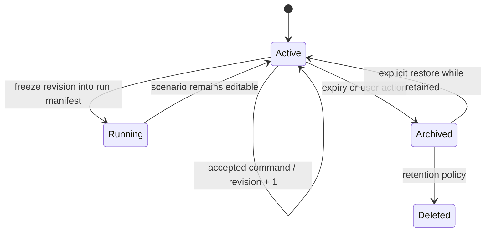

# Map, graph, scenario, and run versioning

## Publication units

A map release is a signed or digest-verifiable manifest that binds source provenance, extraction boundary/date, pipeline commit and configuration, schema versions, attribution, PMTiles objects, directed graph objects, validation report, and checksums. Publication is atomic at the manifest level. Objects are immutable and addressed by version plus digest.

Graph edge and turn identifiers are stable only within a graph version unless a separately validated cross-version mapping exists. Scenarios always name exact map and graph versions; silently resolving `latest` is forbidden in run manifests.

## Scenario lifecycle

A scenario document is mutable through ordered revisions. Historical snapshots are immutable. Deletion behavior must distinguish access revocation, logical tombstone, and eventual object garbage collection.

## Run identity and reproducibility

The semantic run identity is a canonical manifest digest over:

- manifest/schema version;
- scenario snapshot digest and revision;
- map and graph release identifiers/digests;
- model name/version and numerical policy;
- demand generator/version, seed, and demand inputs;
- fixed step and all parameters with explicit units;
- output-profile version;
- compatible engine build identity;
- resource limits that can alter whether output is complete.

Attempt count, worker host, dispatch timestamps, and trace IDs are operational records linked to the manifest but excluded from semantic identity. Results contain their manifest digest and output checksum. A reproduction is valid only when canonical outputs match under the documented equivalence policy.

## Retention and garbage collection

Published map releases are retained according to a declared support policy and cannot be overwritten. Unreferenced staging objects, stale-attempt uploads, expired anonymous scenarios, and cancelled partial results can be collected only after a mark-and-sweep process that respects manifest references and a recovery grace period. Destructive policies require a dry-run report, metrics, and a runbook.
