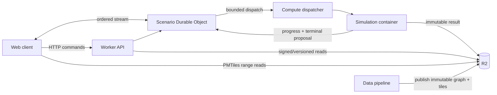

# System design

**Status:** Proposed for phased implementation

## Shape of the system

VECTORSHIFT separates authoritative coordination from expensive computation and immutable data publication.



This diagram is a target, not deployed infrastructure. Phase 0 provisions nothing.

## Planes and responsibilities

| Plane | Component | Owns | Must not own |
| --- | --- | --- | --- |
| Control | Web client | interactions, local drafts, visualization, gap recovery | authoritative revision or run state |
| Control | Worker API | validation, abuse controls, routing, access decisions | simulation algorithms |
| Control | Scenario coordinator | serialized commands, revisions, idempotency, run state, stream sequence | large result blobs |
| Compute | Dispatcher | admission, leases, bounded job delivery | scenario truth |
| Compute | Simulation worker | deterministic execution and result production | public authentication |
| Data | R2 | immutable maps, graphs, snapshots, results | mutable command ordering |
| Data | Pipeline | licensed acquisition, validation, canonical publication | serving public commands |

Postgres/PostGIS is intentionally absent until a measured need for cross-scenario relational or spatial queries appears. A queue is similarly conditional; [ADR 0008](../adr/0008-execution-dispatch.md) defines the trigger.

## Scenario command sequence

```mermaid
sequenceDiagram
  participant B as Browser
  participant A as Worker API
  participant C as Scenario coordinator
  participant S as Immutable snapshot store
  B->>A: PATCH scenario (expected_revision, command_id, operation)
  A->>A: authenticate/authorize, validate, rate-limit
  A->>C: forward canonical command
  C->>C: deduplicate command_id
  alt expected revision matches
    C->>C: apply command; revision += 1; event_seq += 1
    C-->>B: 200 revision + canonical scenario
    C-->>B: stream event(event_seq, revision)
    opt snapshot threshold reached
      C->>S: publish immutable snapshot
    end
  else revision conflicts
    C-->>B: 409 current revision + recovery reference
  end
```

## Run sequence

```mermaid
sequenceDiagram
  participant B as Browser
  participant C as Coordinator
  participant D as Dispatcher
  participant W as Simulation worker
  participant R as Immutable object store
  B->>C: POST run (expected_revision, command_id, idempotency_key)
  C->>C: freeze canonical manifest; admit against budget
  C->>D: dispatch(run_id, manifest_uri, fencing_token)
  D->>W: leased work
  W->>R: conditional-write result objects
  W->>C: terminal proposal(result digest, fencing token)
  C->>C: accept exactly one valid terminal transition
  C-->>B: ordered terminal event + result reference
```

The run manifest includes schema version, scenario snapshot digest, map/graph/model versions, seed and demand version, parameters, numerical policy, build identity, resource budget, and requested outputs. Operational metadata such as attempts and worker identity is recorded separately so retries cannot change semantic identity.

## Deployment topology

Public static assets, Worker API, scenario Durable Objects, and R2 are Cloudflare candidates. Simulation runs in CPU-oriented containers in an independently scalable environment reachable through an authenticated private interface. Environments use distinct accounts/buckets/namespaces and cache prefixes. No public request directly addresses a compute container.

Tracing uses a generated request/command/run correlation chain without placing secrets or full scenario payloads in logs. Structured events include schema version, environment, component, request ID, scenario ID, run ID, revision, sequence, model/map versions, outcome, duration, and resource counters as applicable.

## Failure boundaries

- Coordinator loss recovers from durable state plus the latest verified snapshot and command suffix.
- Worker loss expires a lease; a new fencing token prevents the old worker from publishing authoritative completion.
- Object publication uses temporary keys or multipart staging followed by digest verification and an immutable final key.
- Stream loss is never state loss: clients resume by sequence when retained or fetch a current snapshot and continue from its watermark.
- Edge, compute, and storage overload reject or delay work before unbounded queues or memory growth occur.

See [distributed systems](distributed-systems.md) for invariants and [operations](../engineering/operations.md) for recovery and budgets.
